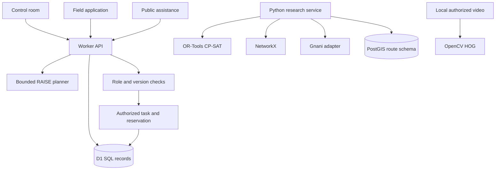
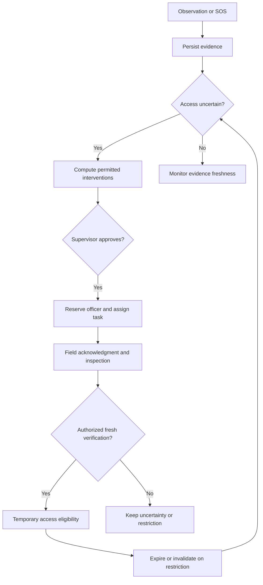

# Architecture

The Python research service is a separate deployable companion, not a currently connected hosted API. Integrating it requires authenticated server-to-server transport and transactional domain persistence.

## API

All mutations are POST JSON with same-origin validation. State is GET `/api/state`. Except advisories, SOS and tracking, routes require the HttpOnly `guardian_session` cookie. This cookie represents an explicitly selectable demo role within an owner-private Site.

| Endpoint | Purpose | Authorized role |
|---|---|---|
| `/api/session` | Get or select synthetic session | Owner-private demo visitor |
| `/api/bootstrap` | Initialize seed data once | Supervisor, Administrator |
| `/api/sos` | Immediately store an assistance report | Public |
| `/api/track` | Retrieve status with id and trackingToken | Holder of random tracking token |
| `/api/plan` | Compute current intervention candidates | Supervisor, Dispatcher |
| `/api/approve` | Reserve officer and create field task | Supervisor |
| `/api/corridor` | Restrict / lift / verify with version | Access officer or Supervisor per action |
| `/api/observation` | Ingest synthetic camera observation | Camera operator, Access officer, Supervisor |
| `/api/assign` | Reserve qualified responder | Dispatcher, Supervisor |
| `/api/task` | Authorized task lifecycle | Matching field role, Supervisor |
| `/api/incident` | Incident lifecycle transition | Supervisor, Dispatcher, clinical/rescue roles |
| `/api/voice` | Store explicitly manual transcript | Authenticated demo role |
| `/api/scenario` | Replay scenario 1–6 | Supervisor, Administrator |
| `/api/settings` | Persist policy settings | Administrator |
| `/api/advisory` | Approve public guidance | Supervisor |
| `/api/export` | CSV incident export | Control-room roles |

Python API OpenAPI documentation is at `http://localhost:8000/docs` when running the companion. Set the `Authorization: Bearer <SERVICE_API_KEY>` header for its research endpoints.

## Database

D1 migrations live in `drizzle/`. `records` stores typed JSON documents with indexed `kind`, unique `id`, SQL `version`, and `updated` timestamp. `reservations` has a unique responder primary key; `sessions` holds expiring opaque tokens; `audit` stores actor, action, record, before/after and timestamp. This is a compact document-oriented SQL schema, not the normalized full domain schema requested for a future production system.

PostGIS setup is in `infra/postgis.sql`. No real geographic data is bundled.
